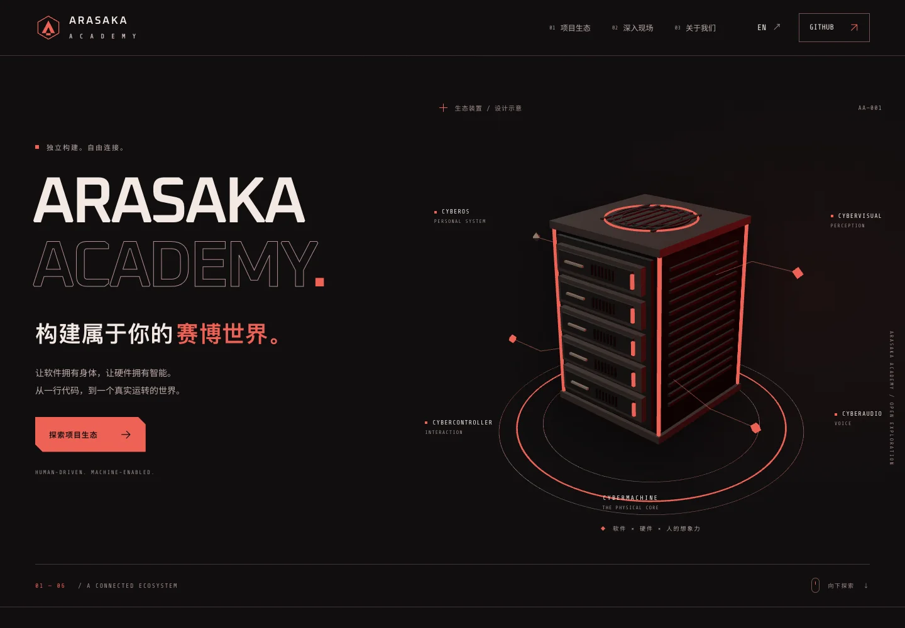
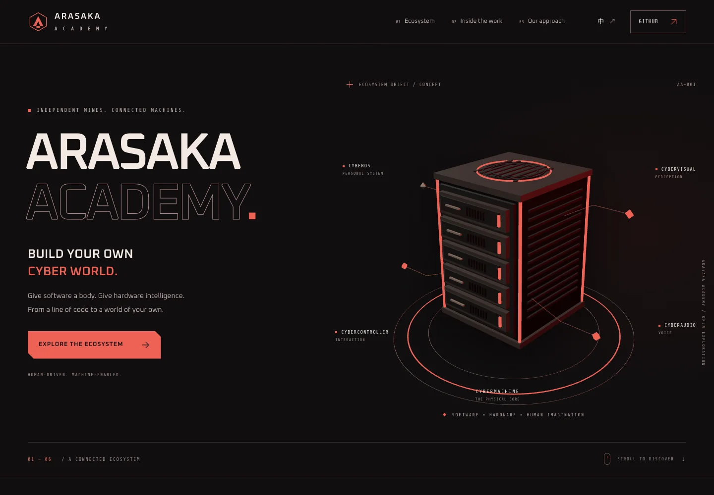
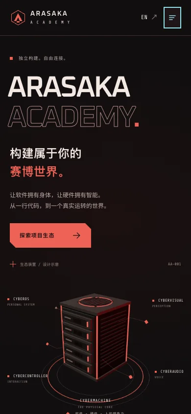
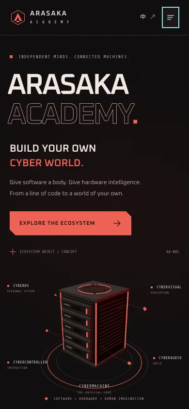

# Arasaka Academy

Arasaka Academy 的中英双语组织官网。黑红工业视觉以 CyberUI 为基础，将系统、硬件、视觉、控制、语音与设计连接为一个可继续扩展的项目生态。

- 中文：https://arasaka-academy.github.io/
- English: https://arasaka-academy.github.io/en/
- 技术：Next.js 静态导出、React 19、TypeScript、Tailwind CSS 4、Three.js、Motion。
- 无后端、登录、统计追踪或运行时 GitHub API 依赖。

## 页面预览

| 中文桌面 | English desktop |
| --- | --- |
|  |  |

| 中文手机 | English mobile |
| --- | --- |
|  |  |

截图来自生产静态构建；验证范围与发布状态见 `docs/verification.md`。

## 本地开发

要求 Node.js 22.13+ 和 pnpm 11.3.0。

```sh
corepack enable
pnpm install --frozen-lockfile
pnpm dev
```

```sh
pnpm check
pnpm exec playwright install chromium
pnpm test:e2e
pnpm preview
pnpm audit:performance
node scripts/capture-homepage.mjs
```

`pnpm build` 生成 `out/`，可直接由静态 HTTP 服务托管。`pnpm preview` 默认监听 4173；性能审计及截图命令要求预览服务已启动。`SITE_URL` 可指定另一个测试地址。

## 新增项目

1. 在 `src/content/projects.ts` 的 `projects` 中增加一项，使用唯一 `id`，填写中英文 `content`、名称、编号、源码链接和图片；`website` 可选。
2. 将图片放进 `public/images/`，补齐中英文 `imageAlt` 与来源说明。普通项目不需要 `featured`，网格自动接纳新条目。
3. 更新内容测试中的预期项目清单，执行 `pnpm check` 和浏览器测试。
4. 若增加了中文字符，运行字体子集脚本，避免自托管字体遗漏新增字形。

首页的五个章节和双语文案集中在 `src/content/copy.ts`。`/` 为中文、`/en/` 为英文，分别输出正确的静态 `lang`、canonical 和 hreflang。导航语言切换保留章节；不按 IP 或浏览器语言强制重定向。

## 设计与素材

- CyberUI 源码固定到 `e31c0355b2b5189c9af1e6e26150f28a44287659`。`node scripts/sync-cyberui.mjs` 从官方 registry 下载按钮、图标及其必要源码；校验值记录在组件目录的 `PROVENANCE.json`。许可文件随源码保留。
- 三维主视觉是根据 CyberMachine 比例制作的轻量生态示意，不是制造 CAD，不提供运行状态或制造精度承诺。
- 三维仅对支持 WebGL 的桌面精细指针设备增强。移动端、节流流量、减少动态、WebGL 不可用及加载失败均保留静态海报。离屏和后台页面暂停，销毁时释放 GPU 资源。
- 产品图、海报、字体均自托管。素材来源与重新生成方法见 `docs/media-sources.md`。

## GitHub Pages

公开仓库必须命名为 `Arasaka-Academy/arasaka-academy.github.io`。Settings → Pages → Source 选择 **GitHub Actions**。主分支推送通过检查后自动部署；PR 仅运行检查，不部署。

发布工作流依次执行锁定依赖安装、类型与代码检查、内容测试、静态构建、真实浏览器测试，然后将 `out/` 发布到 Pages。部署任务单独持有 `pages:write` 与 `id-token:write` 权限。

本仓库不管理或覆盖 CyberUI、CyberMachine 等其他项目的 Pages 子站。不设置自定义域名。回滚时恢复到已验证提交并重新运行工作流，不修改其他项目的发布配置。
